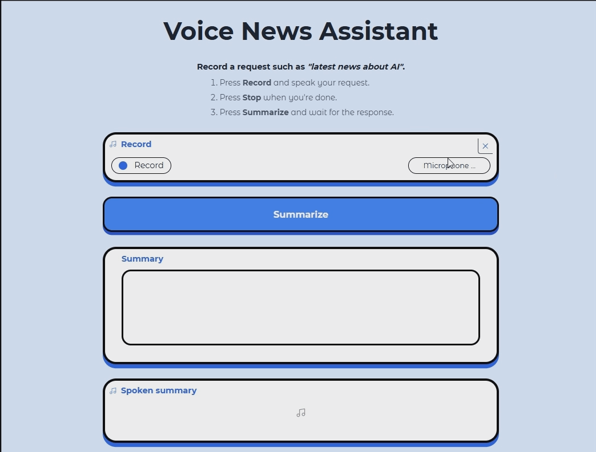

# Voice News Assistant



Record a spoken request and get a short, spoken news summary.

**Live demo:** https://huggingface.co/spaces/Canaximui1302/voice_web_search


## How it works

```mermaid
flowchart TD
    A[User records a spoken request] --> B[Whisper: speech to text]
    B --> C[TinyFish web search: find pages]
    C --> D[Fetch page content]
    D -- Fetch fails or site blocks it --> D
    D -- Content fetched --> E[Qwen3-0.6B]
    E --> F[Kokoro: text to speech]
    F --> G[Gradio UI: play spoken summary]
```****


1. **Speech to text:** your recording is transcribed with Whisper (`openai/whisper-base.en`).
2. **Search and fetch:** TinyFish's `search.query` finds a list of URLs for the request, and TinyFish's `fetch.get_contents` tries the list of URLs for content fetching until first successful fetch.
3. **Summarize:** Qwen3-0.6B writes a ~200-word news report from the fetched page.
4. **Text to speech:** Kokoro reads the summary aloud.

The UI is built with Gradio.

## Run it locally

    python -m venv .venv
    .venv\Scripts\activate
    pip install -r requirements.txt
    set TINYFISH_API_KEY=your_key
    python app.py

A TinyFish account and API key are needed for web search and fetch (https://agent.tinyfish.ai/api-keys).

## Notes and limitations

- The free CPU Space is slow, so a request can take a while.
- Small model: summaries can miss details or contain mistakes, so check them against the source.
- Some news sites block automated fetching, so the app skips to the next result.
- The live demo uses a limited API quota and may stop working when it runs out.

## Credits

Whisper, Qwen3, Kokoro, Gradio, Hugging Face Transformers, TinyFish. Check each model's license before reusing.

Built by Nguyen Ho Minh Khanh.
