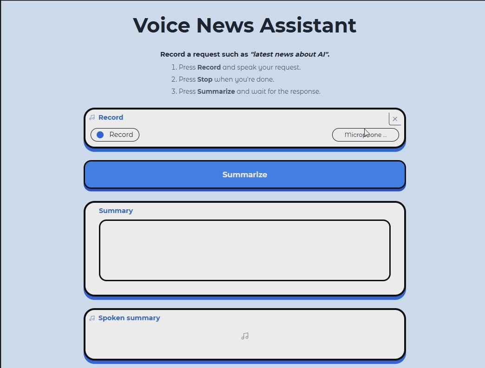

# Voice News Assistant

Record a spoken request and get a short, spoken news summary.

**Live demo:** https://huggingface.co/spaces/Canaximui1302/voice_web_search

## How it works

1. **Speech to text:** your recording is transcribed with Whisper (`openai/whisper-base.en`).
2. **Search and fetch:** Ollama's web search finds pages for the request, and try to fetch the URLs for content.
3. **Summarize:** Qwen3-0.6B writes a ~200-word news report from the fetched page.
4. **Text to speech:** Kokoro reads the summary aloud.

The UI is built with Gradio.

## Run it locally

    python -m venv .venv
    .venv\Scripts\activate
    pip install -r requirements.txt
    set OLLAMA_API_KEY=your_key
    python app.py

An Ollama account and API key are needed for web search and fetch (ollama.com/settings/keys).

## Notes and limitations

- The free CPU Space is slow, so a request can take a while.
- Small model: summaries can miss details or contain mistakes, so check them against the source.
- Some news sites block automated fetching, so the app skips to the next result.
- The live demo uses a limited API quota and may stop working when it runs out.

## Credits

Whisper, Qwen3, Kokoro, Gradio, Hugging Face Transformers, Ollama. Check each model's license before reusing.
